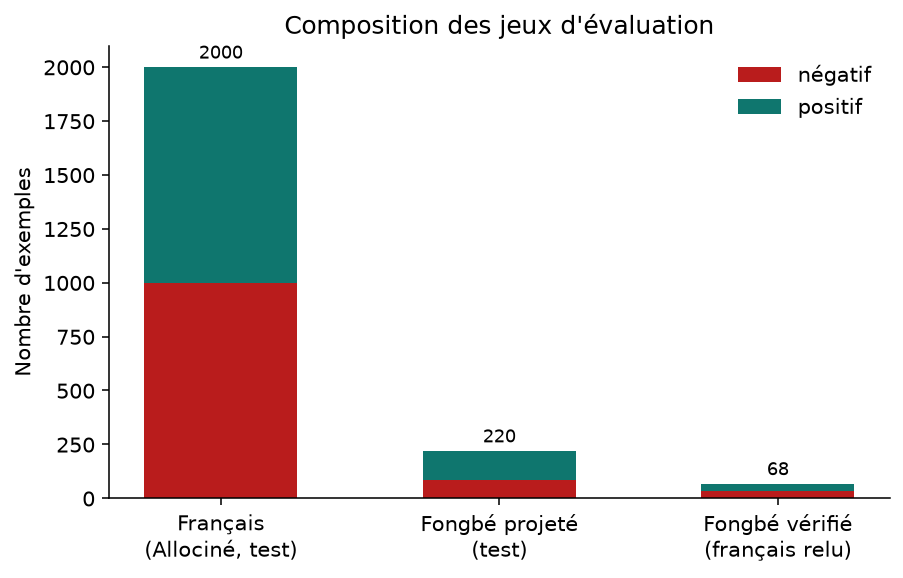
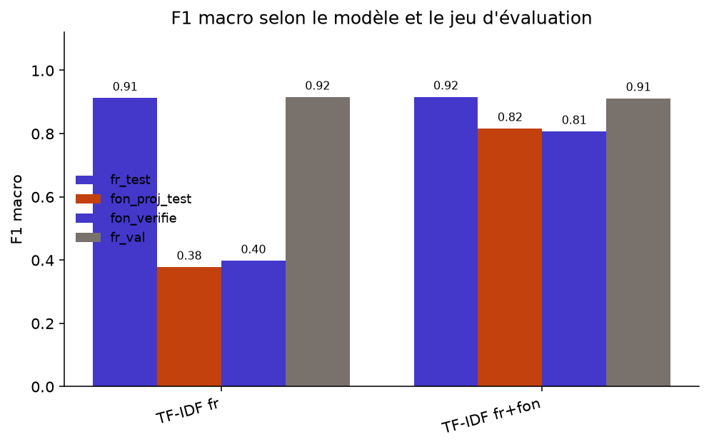
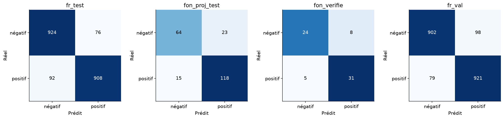
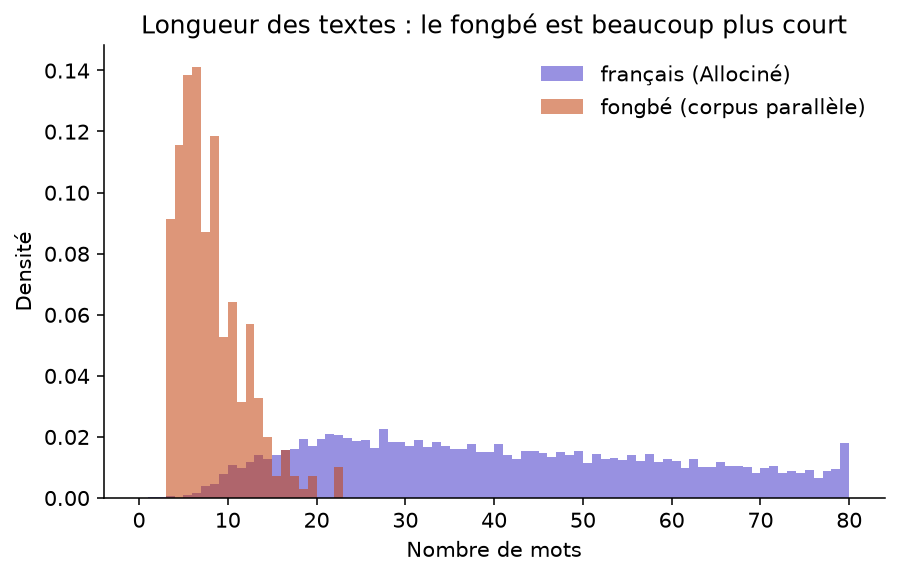

# Analyse de sentiment en français et en fongbé


**Démo en ligne : [sentiment-francais-fongbe.onrender.com](https://sentiment-francais-fongbe.onrender.com)** — hébergement gratuit : le premier chargement peut prendre une minute.

Classer une phrase comme **positive** ou **négative**, en **français** ou en
**fongbé**, et reconnaître d'abord la langue. Le français s'appuie sur des
critiques Allociné (étiquettes d'origine). Pour le fongbé, il n'existe pas de
corpus annoté par des locuteurs natifs : la polarité est transférée depuis le
français d'un corpus parallèle ouvert, puis contrôlée à la main sur un petit
jeu. Une démo Streamlit, légère, fait les deux gestes.

*Binary sentiment classification for French and Fon (Fongbe), with language
identification. French labels come from Allociné reviews; Fon labels are
projected from a CC BY 4.0 parallel corpus and checked on the French side.*

## Contexte

Le fongbé est une langue majoritaire au Bénin, très peu représentée en
traitement automatique des langues. On trouve des corpus parallèles Fon–Français
et des outils d'identification de langue, mais **pas de jeu de sentiment
annoté par des locuteurs natifs**. AfriSenti, la référence pour le sentiment en
langues africaines, couvre 14 langues et n'inclut pas le fon.

La question est donc double, et il faut rester honnête sur la seconde : un
modèle de sentiment français classique tient-il la route ? Et que peut-on dire,
avec les données ouvertes dont on dispose réellement, d'un modèle pour le fongbé ?

## Données

Détails, licences et attributions : [`data/README.md`](data/README.md).

| | |
| --- | --- |
| **Français** | [Allociné](https://huggingface.co/datasets/tblard/allocine) (Blard, 2020) — critiques de films, polarité binaire d'origine, licence **MIT**. Sous-échantillons équilibrés 10 000 / 2 000 / 2 000, découpage officiel conservé |
| **Fongbé (projection)** | Corpus parallèle Fon–Français, édition consolidée [Flex1-tech](https://huggingface.co/datasets/Flex1-tech/fon-french-parallel-corpus) d'après [Dossou et al., 2021](https://doi.org/10.5281/zenodo.4432712) et [Degila et al., 2020](https://doi.org/10.5281/zenodo.4266935), **CC BY 4.0**. 1 036 paires à polarité lexicale univoque, découpées par groupes : 701 / 115 / 220 |
| **Fongbé (vérifié)** | 68 phrases (36 positives, 32 négatives) : polarité **relue sur le français**, étiquette transférée au fongbé, hors apprentissage |
| **Écarté** | [fon-sentiments-corpus](https://huggingface.co/datasets/michsethowusu/fon-sentiments-corpus) (MIT, 34 915 lignes) : étiquettes automatiques (DistilBERT anglais) et mélange de langues visible (seulement 42 % des lignes portent une lettre typique du fongbé) |

**Projection.** Un lexique français conservative (`src/lexique.py`) n'étiquette
une phrase que s'il trouve des indices d'un seul côté, avec des frontières de
mots. Les phrases niées (`ne … pas`) ou figées (`nulle part`, `de peur que`,
`avoir beau`) sont écartées, pas inversées. Un modèle entraîné sur Allociné,
essayé d'abord, classait presque tout le dialogue court en « négatif » : décalage
de domaine, donc abandonné pour cette étape.

## Questions

1. Sur des critiques françaises tenues à l'écart, un modèle simple (TF-IDF et
   régression logistique) atteint-il un F1 macro solide ?
2. Ce même modèle, sans avoir vu de fongbé, s'applique-t-il au fongbé ? (on
   s'attend à ce que non : le vocabulaire n'est pas le même.)
3. En apprenant aussi sur les phrases fongbé projetées, gagne-t-on sur le
   fongbé sans perdre le français ?
4. Que valent ces chiffres sur le petit jeu relu, plus honnête que le test
   projeté seul ?
5. Français et fongbé se distinguent-ils facilement à l'écrit ?

## Résultats clés

Chiffres produits par le code (`reports/key_figures.json`, `reports/metrics.md`).

**1. En français, le modèle simple est déjà solide.** TF-IDF (n-grammes de mots
et de caractères) et régression logistique, entraîné sur 10 000 critiques :
**F1 macro 0,912** sur les 2 000 critiques du test officiel (autant de positifs
que de négatifs). La validation donne 0,915 : pas de décalage suspect.



**2. Sans fongbé dans l'apprentissage, le transfert lexical échoue.** Le même
modèle appliqué au test fongbé projeté tombe à un F1 macro de **0,378**
(0,398 sur le jeu relu). Il rate presque tous les positifs. C'était attendu :
un sac de mots français ne lit pas le fongbé.

**3. En ajoutant les phrases projetées, le fongbé devient accessible, et le
français ne recule pas.** Le modèle mixte (français + 701 phrases fongbé) monte même un peu, à **0,916** sur le test Allociné, et passe à **0,816** sur le test fongbé
projeté (220 phrases) et à **0,807** sur les 68 phrases relues.





Le 0,816 du test projeté est un peu optimiste : on y mesure l'accord avec une
étiquette elle-même projetée. Le **0,807 du jeu relu** est le chiffre à retenir
pour le fongbé. Sur ces 68 phrases, 13 erreurs subsistent : proverbes, phrases
très courtes, ou un mot-clé français qui n'a pas de trace évidente dans le
fongbé correspondant.

**4. Distinguer les deux langues est facile.** N-grammes de caractères :
**F1 macro 0,997** (exactitude 0,998) sur 6 700 textes tenus à l'écart. L'alphabet
du fongbé (ɔ, ɛ, ɖ, tons) porte déjà une grande partie du signal ; ce score
élevé n'est pas une surprise et ne doit pas être lu comme un exploit.



Les critiques Allociné sont nettement plus longues que les phrases du corpus
parallèle. C'est un décalage de domaine réel, y compris en français.

## Méthode

- **Normalisation** Unicode NFC, indispensable pour le fongbé.
- **Référence française** : TF-IDF (mots 1–2, caractères 3–5) et régression
  logistique, entraînée seulement sur Allociné.
- **Modèle mixte** (celui de la démo) : la même architecture, entraînée sur
  Allociné, sur le français court des paires d'apprentissage, et sur le fongbé
  projeté. Sans ces phrases courtes, le modèle (nourri surtout de critiques de
  films) se trompait sur « je suis heureux ».
- **Identification de langue** : TF-IDF de caractères (1–4) et régression
  logistique, français contre fongbé.
- **Partitions fongbé** par groupes lexicaux, jeu relu entièrement à part.
- **Transformeur** : un fine-tuning court de MiniLM multilingue (une époque,
  sous-ensemble, CPU) est prévu dans `src/transformer_train.py`. Il est
  optionnel : la démo n'en dépend pas, afin de rester dans 512 Mo de mémoire.

Les n-grammes les plus distinctifs du modèle français sont bien ceux qu'on
attend (*excellent*, *déçu*, *nul*, *magnifique*). Dans le modèle mixte
apparaissent aussi des morphèmes fongbé (voir `reports/figures/05_coefficients_fr.png`
et `06_coefficients_mix.png`).

## Limites

- **Pas d'annotation native en fongbé.** Le 0,777 mesure l'accord avec une
  polarité lue en français et transférée, sur 68 phrases seulement. Un locuteur
  natif devrait relire ce jeu, et à terme en annoter un plus grand.
- **Le lexique est étroit.** Beaucoup de phrases du corpus parallèle restent
  sans étiquette (descriptions neutres, entrées de dictionnaire). Les phrases
  étiquetées sont plus « marquées » que le parler quotidien.
- **Décalage de domaine.** Critiques de films d'un côté, dialogues et exemples
  courtes de l'autre. Une partie des erreurs vient de là.
- **Pas de classe neutre.** Tout est ramené à positif / négatif.
- **L'identification de langue est une tâche facile** à l'écrit, entre ces
  deux langues ; elle ne dit rien d'un mélange de langues dans un même message.

## Comment lancer le projet

```bash
python3 -m venv .venv
source .venv/bin/activate
pip install -r requirements.txt
pytest -q
streamlit run app.py
```

Les jeux traités et les modèles TF-IDF sont déjà dans `data/processed/` et
`models/`. Pour tout reconstruire (téléchargement des sources, projection,
entraînement, figures) :

```bash
python -m src.pipeline
```

L'application demande seulement `requirements-app.txt` (pas de PyTorch) et
tient dans un hébergement gratuit typique.

## Licence

Le code est sous licence MIT. Les données conservent leurs conditions d'origine
(Allociné : MIT ; corpus parallèle : CC BY 4.0). Voir le fichier `LICENSE` et
[`data/README.md`](data/README.md).
